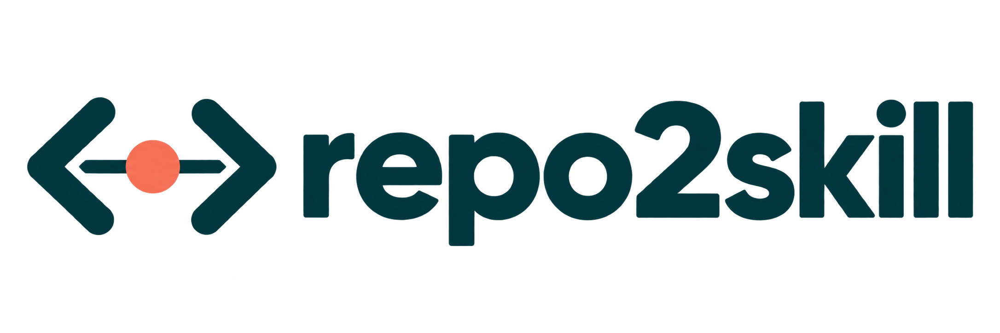
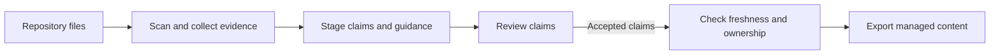

# repo2skill

<p align="center">
  <picture>
    <source media="(prefers-color-scheme: dark)" srcset="assets/repo2skill-logo-dark.png">
    
  </picture>
</p>

<p align="center"><strong>Turn a codebase into reviewable, evidence-linked guidance for coding agents.</strong></p>

<p align="center">
  <a href="https://www.python.org/downloads/"></a>
  
  <a href="https://github.com/vinhky123/repo2skill/actions/workflows/ci.yml"></a>
</p>

<p align="center">
  <a href="#why-repo2skill">Why repo2skill</a> ·
  <a href="#quick-start">Quick start</a> ·
  <a href="#what-it-does">What it does</a> ·
  <a href="#optional-committed-change-maintenance">Maintenance</a> ·
  <a href="#docs">Docs</a>
</p>

## Why repo2skill

Useful repository guidance should be traceable to the files it came from. repo2skill records evidence and provenance, stages an `AGENTS.md` guide and an Agent Skill, and lets you review claims before exporting them. Its local, no-AI workflow does not call the network or run commands from the repository.

The project is an unpublished local alpha. It currently extracts shallow signals from JavaScript/TypeScript, Python, Go, and Rust, along with generic configuration and CI files. It is not a full call-graph analyzer, and evidence links do not prove that generated guidance is complete or correct. Review the output before using it.

## Quick start

Python 3.11 or newer is required. Clone the source with Git, then install the command with `pipx` from the checkout. This project is not published to PyPI.

```sh
git clone https://github.com/vinhky123/repo2skill.git
cd repo2skill
python -m pip install --user pipx
python -m pipx ensurepath
python -m pipx install .
```

If `pipx` is not available as a command after `ensurepath`, reopen the terminal. Installation may download Python dependencies from your configured package index; that is separate from repository processing.

From the repository you want to document, generate and inspect a local draft:

```sh
cd path/to/your/repository
repo2skill init
repo2skill generate --no-ai
repo2skill review list --status pending
```

Review a claim using an ID shown by `review list`, then accept only claims you agree with. Replace `CLAIM_ID` below with that ID:

```sh
repo2skill review show --claim CLAIM_ID
repo2skill review accept --claim CLAIM_ID
repo2skill export
repo2skill check
```

Generation writes to local staging. Export writes accepted claims to the configured outputs after checking ownership and freshness; conflicts preserve existing bytes and need manual review. `check` can exit 3 while claims remain pending review; review those proposals and rerun it when you want a fresh result. See the [installation guide](docs/install.md) for Windows and maintainer setup details.

## What it does

| Capability | What to expect |
| --- | --- |
| Evidence and provenance | Records source hashes, evidence locations, and the origin of claims so you can trace a draft back to the observed repository snapshot. |
| Review before export | Separates staged guidance from live files; you choose which claims to accept before export. |
| Ownership-aware updates | Tracks the spans it owns, preserves surrounding hand-written content, and reports conflicts instead of silently overwriting edits. |
| Local by default | No-AI generation and `check` make no network requests and execute no repository commands. Package installation may use your package index. |
| Optional change maintenance | Queues work from committed Git changes. A job waits for your approval before the installed headless Codex adapter runs and applies a validated update. |



## Optional committed-change maintenance

Maintenance can queue bounded guidance updates after supported committed Git events. The first baseline is explicit: setup hooks, rebuild the catch-up snapshot, inspect the queued job, and approve its exact ID before the installed headless Codex adapter runs.

```sh
repo2skill init
repo2skill maintain setup
repo2skill maintain catch-up --rebuild
repo2skill maintain status
```

`status` shows the job ID. Review the job, then replace `JOB_ID` with that value to authorize its run:

```sh
repo2skill maintain approve JOB_ID
repo2skill maintain status
```

Jobs wait for approval by default. `maintain setup --auto-approve` is an explicit opt-in for newly queued eligible jobs. Hooks observe common Git events but may miss other changes, so run `maintain catch-up` when needed. Maintenance reads committed context and does not automatically commit or push. Its provenance checks bind the source bytes and authorized job; they do not prove model-written prose is semantically correct or establish complete isolation from local authentication and instruction loading.

The current committed-context limits are 256 files, 2 MiB per file, and 16 MiB total. A required source fragment is capped at 256 lines and 32 KiB; an oversized required file is rejected before an AI call rather than silently truncated. See the [maintenance CLI contract](docs/engineering/cli-contract.md#maintain) for exact behavior and exit codes.

## Docs

- [Install and run locally](docs/install.md)
- [CLI contract](docs/engineering/cli-contract.md)
- [Threat model and boundaries](docs/threat-model.md)
- [Schema compatibility](docs/schema-migrations.md)
- [Contributing](CONTRIBUTING.md)
- [Contributors](CONTRIBUTORS.md)
- [Upstream source map and retained notice](docs/engineering/upstream-source-map.md)

Local verification has been performed on Windows/Python 3.13. The CI matrix targets Windows, Linux, and macOS on Python 3.11 and 3.13; see the CI badge above for the latest hosted results.
