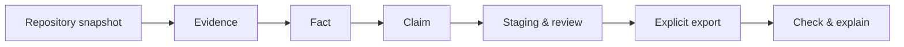

# repo2skill

> **Trạng thái hiện tại:** nền tảng package/policy của P0-01 đã được triển khai và đang chờ independent review. Package cài được ở chế độ development, nhưng CLI hiện chỉ chạy `--help` và `--version`; P0-02 đến P0-12 chưa được triển khai.

repo2skill được thiết kế như một generator tri thức repository có truy vết, chạy local-first. Nó sẽ đọc repository, tạo evidence và fact có kiểu, dựng claim có thể review, rồi sinh managed content cho `AGENTS.md`, một Agent Skill portable và báo cáo provenance. Người dùng đầu tiên được giả định là maintainer hoặc senior developer của repository đa ngôn ngữ đã dùng coding agent, nhưng cần biết mỗi command, path hay convention được lấy từ đâu và còn đúng với snapshot hiện tại hay không.

## Phạm vi MVP

P0 là alpha local, không AI và phải tự đứng vững: inventory an toàn; snapshot Git, dirty worktree hoặc no-Git; evidence/fact/claim ledger; collector nông cho JavaScript/TypeScript, Python, Go và Rust; generic inventory/CI/config cho ngôn ngữ khác; proof-preserving dedup; staged generation; review; managed ownership; explicit export; drift detection; `check`, `explain` và reporting. Scanner không chạy build, test, install, migration hoặc command lấy từ repository.

Baseline implementation có điều kiện là Python `>=3.11`, adapt có chọn lọc primitive/rule MIT hữu ích từ `osmaneb23/agents-md` tại SHA `346b5f78dcbb48d9a700df98ac7f5f8e02f751ea`. Đây không phải kế hoạch port nguyên scanner/generator/fingerprint và không xem API nội bộ upstream là ổn định. Attribution và provenance của code tái sử dụng là yêu cầu release.

P1 chỉ bắt đầu sau khi P0 đã chứng minh generation, ownership và drift end-to-end. P1 thêm adapter tùy chọn cho official Codex CLI đã được người dùng cài và cấu hình, cùng pilot cohort nhỏ. Không hardcode model alias, không quản lý API key và không làm no-AI phụ thuộc model. P2 như JVM native, monorepo sâu, extractor domain mới hoặc thêm output target chỉ mở khi pilot cho thấy nhu cầu lặp lại.



## Tài liệu có thẩm quyền

Đọc theo thứ tự sau trước khi bắt đầu implementation:

1. [MVP design](docs/superpowers/specs/2026-10-07-repo2skill-mvp-design.md) là đặc tả kiến trúc canonical.
2. [CLI contract](docs/engineering/cli-contract.md) là contract canonical cho command, state transition, output và exit code.
3. [Feature catalog](docs/product/feature-catalog.md) xác định feature ID, phase, priority và acceptance.
4. [Project start](docs/project-start.md) là checklist đưa đặc tả vào công việc có thể review.
5. [P0 local-generator plan](docs/superpowers/plans/2026-10-07-local-generator.md) và [P1 Codex/pilot plan](docs/superpowers/plans/2026-10-07-codex-pilot.md) là hai kế hoạch triển khai chi tiết.
6. [Pilot validation](docs/product/pilot-validation.md) định nghĩa giả thuyết, cohort, metrics và cổng continue/narrow/stop.

Nếu tài liệu cũ mâu thuẫn về interface hoặc lifecycle, MVP design và CLI contract ở trên chi phối implementation; catalog chi phối ưu tiên. [Project scope](docs/project-scope.md), [technology/reuse decision](docs/technology-reuse-decision.md), [reuse/provenance design](docs/reuse-and-provenance-design.md), [upstream audit](docs/upstream-reuse-audit.md) và các deep dive là bằng chứng hỗ trợ hoặc lịch sử quyết định. Chúng không chứng minh rằng sản phẩm, user base, benchmark hay production support đã tồn tại.

## Bắt đầu công việc

Cần Python 3.11 trở lên. Quickstart local trên Windows PowerShell:

```powershell
python -m venv .venv
.\.venv\Scripts\python.exe -m pip install -e '.[dev]'
.\.venv\Scripts\python.exe -m pytest
.\.venv\Scripts\python.exe -m build
.\.venv\Scripts\repo2skill.exe --help
```

Các lệnh này cài package local, chạy test, build wheel/sdist và hiển thị help. CLI hiện chưa có `init`, `scan`, `generate`, `review`, `export`, `check`, `explain`, `report` hoặc `doctor`; chỉ `repo2skill --help` và `repo2skill --version` là runnable.

P0-01 đã khóa package bootstrap, ba policy/target record nền tảng, default versioned, confinement cho output path, attribution và reuse map. Công việc tiếp theo bắt đầu từ P0-02 trong local-generator plan; P0-02 đến P0-12 vẫn pending.

Ngoài hai global option hiện có, mọi command sản phẩm xuất hiện trong tài liệu hiện nay đều là **FUTURE** hoặc ví dụ contract. Không dùng chúng như hướng dẫn chạy generation, và không quảng bá package đã publish. Mỗi thay đổi tương lai cần trỏ tới feature ID, acceptance/fixture tương ứng và giữ thứ tự P0 hoàn chỉnh trước P1 Codex/pilot.
